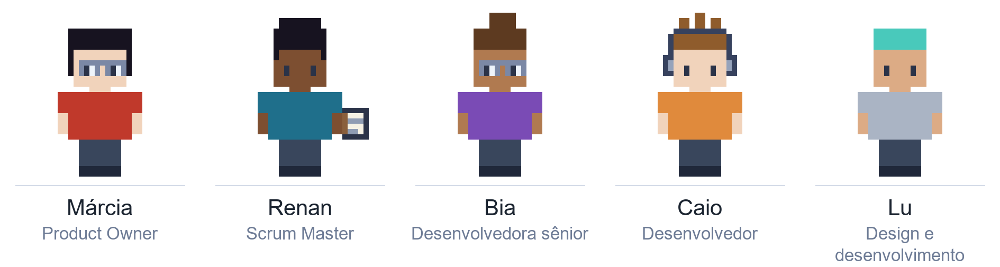
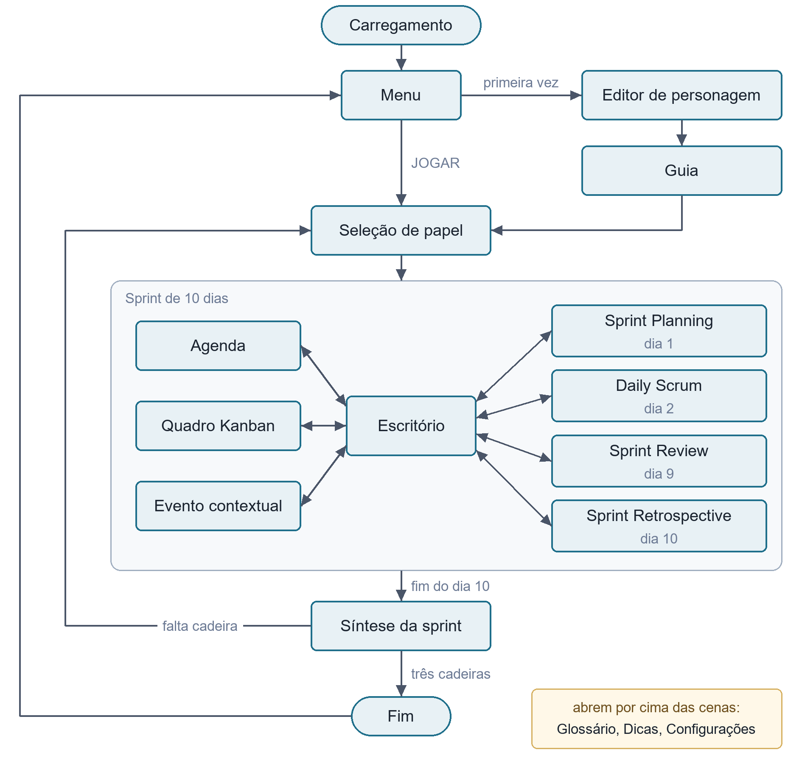

# Jogo sério de Scrum

Protótipo web de um jogo sério com elementos de gamificação para o ensino de Scrum e do quadro Kanban, desenvolvido como Trabalho de Conclusão de Curso de Engenharia de Computação na UTFPR, câmpus Cornélio Procópio.

O jogador entra como aprendiz em uma empresa de software fictícia e vive a mesma sprint de dez dias em três cadeiras, Product Owner, Scrum Master e desenvolvedor, cada uma com um mentor. Os quatro eventos do Scrum são mecânicas jogáveis, o quadro Kanban limita o trabalho em progresso, e eventos contextuais sem o mentor, medidores, pontuação e conquistas acompanham as decisões.



## Como jogar

### GitHub Pages

O jogo está disponível no [GitHub pages](https://lututui.github.io/jogo-scrum).

### Auto-hospedado

O jogo roda no navegador, mas precisa ser servido por HTTP: abrir o `index.html` direto do disco não funciona, porque os módulos JavaScript não carregam pelo protocolo `file://`.

Com o [Node.js](https://nodejs.org/) instalado, na pasta do projeto:

```bash
npm start
```

O jogo fica em `http://localhost:8000`. Para usar outra porta, defina a variável `PORTA`. O servidor não tem dependências, e a biblioteca [Phaser 3](https://phaser.io/) já está em `vendor/`.

### Opções de depuração

O servidor aceita opções que facilitam os testes:

```bash
node servidor.js --depuracao=eventosLivres,trocaDeCadeiraLivre
node servidor.js --depuracao=tudo
```

| Opção | Efeito |
| --- | --- |
| `eventosLivres` | Abre qualquer reunião em qualquer ordem |
| `trocaDeCadeiraLivre` | Troca de cadeira sem terminar a sprint |
| `atalhoDeSintese` | Encerra a sprint e abre a síntese a qualquer momento |
| `npcsDeTeste` | Mantém os personagens da escola no escritório |
| `expressoesEmCiclo` | Alterna as expressões dos retratos a cada fala |

## Fluxo do jogo



## Estrutura

```
index.html          página do jogo
servidor.js         servidor estático local
src/cenas/          cenas do Phaser
src/dados/          roteiro, regras, progresso e diário de uso
src/ui/             componentes de interface
assets/             imagens e sons gerados
vendor/             Phaser 3
tools/              geradores de imagens e sons, e testes das camadas
figuras/            figuras usadas no texto do TCC
```

O conteúdo pedagógico (falas, opções, avaliações e princípios) fica em `src/dados/`, separado da lógica das cenas.

## Imagens e sons

Todos os recursos visuais e sonoros são gerados por scripts em Python 3:

```bash
pip install -r tools/requirements.txt
python tools/gerar_tudo.py            # jogo e figuras do texto
python tools/gerar_tudo.py --so-jogo  # só assets/
python tools/testar_camadas.py        # testes de montagem dos personagens
```

## Dados de uso

O progresso e um diário de uso ficam no armazenamento local do navegador, sem servidor nem cadastro. Pelas configurações do jogo, é possível exportar esses dados em um arquivo `.json` ou apagar tudo.

## Licença

Código e recursos sob a licença [Creative Commons Atribuição-NãoComercial-CompartilhaIgual 4.0 Internacional](LICENSE) (CC BY-NC-SA 4.0). O Phaser, em `vendor/`, é distribuído sob a sua própria licença, a MIT.

## Autoria

Luiz Arthur Chagas Oliveira, sob orientação da Profª. Drª. Eduarda Maganha de Almeida. Universidade Tecnológica Federal do Paraná, câmpus Cornélio Procópio, 2026.
